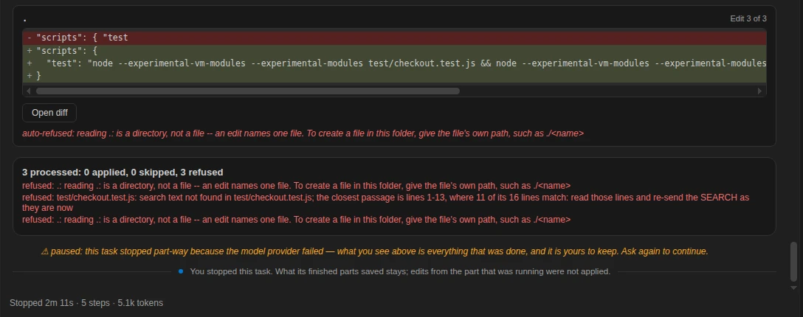

A long task keeps working on one job (find and fix a bug, refactor, hunt for bugs) across many steps, within a time and spend budget, and you can pick it up again later.

*Describes terminal app 1.6.1 and VS Code extension 1.0.1, which works with terminal app 1.6.1 or later.*

Long tasks need agent mode, so a model that can use tools.

## In the terminal app

| Command | What it does |
|---|---|
| `/fix <bug>` | Reproduces the bug, fixes it, and verifies the fix |
| `/debug <issue>` | Reproduces, localises, fixes at the root, and verifies |
| `/refactor <change>` | Starts from a green baseline and changes the code in small steps, each built and tested |
| `/hunt <area>` | Looks for real bugs only, each proved by a failing run (also in VS Code) |
| `/task <goal>` | Any long task |

**How it works.** The task runs in segments of up to 20 model calls. Each starts small: your request plus the task's ledger, which holds the plan, the findings with their evidence, the files changed, the last check and a handoff from the segment before. All segments work in one separate working copy of the project, and you review every change once, when the task ends.

**Finishing is a gate.** A task can finish only after a passing build or test run with no edit since. `/hunt` is the exception: its proof is failing runs. A finding without evidence (a command the task ran, or a `file:line` that exists) is refused.

**It stops by itself** when it finishes or needs you, when it reaches its budget, when two segments in a row change nothing, or when you press `Esc`.

| Budget | Default | Change it |
|---|---|---|
| Time | 30 minutes | `/task budget 45m $1 200` (minutes, dollars, model calls) for this session |
| Spend | $0.50 | |
| Model calls | 150 | |

**Pause and resume.** The ledger and the diff are saved after every segment, under `~/.local/state/mochiii/tasks/`, never in the project.

| Command | What it does |
|---|---|
| `/task` | Where the task stands |
| `/task resume [note]` | Carries on from the last saved point; your note goes into the ledger |
| `/task review` | Offers the saved changes for review, without calling the model |
| `/task discard` | Drops the saved task |

A long task does not use the web tools, and a yes for this turn at an approval lasts the whole task.

## In VS Code

{/* SCREENSHOT GAP: Resume after an hour or 400 steps. Not reached with a local CPU model. */}

In **Auto** and **Plan**, a task continues by itself: when a turn ends at a limit its edits are kept, and the next part starts from a handoff with the request, the task list, the files saved and the last check. It goes on for up to an hour or 400 steps, then offers **Resume**. In **Manual**, where an edit waits for you, nothing continues by itself.

| Limit | VS Code |
|---|---|
| A task | 1 hour or 400 steps, then **Resume** |
| One part (segment) | 25 steps or 10 minutes |
| Spend | 15,000,000 tokens or $5.00 a day, the same for one VS Code window's session (see [Spending limits](/features/spending-limits)) |

`/hunt` runs as in the terminal app: the background service runs it as a long task with its own budget (30 minutes, $0.50, 150 model calls), and a line in the chat marks each segment. When it stops before it is finished, **Resume** carries it on from its saved point. `/fix`, `/debug` and `/refactor` are prompts in VS Code, and continue as any task does.

A line over the composer shows the time, the steps and the tokens while the task works, and the totals when it ends.

<Note>
  Mochiii's own comparison found no advantage yet for a long task over the ordinary agent plus you typing "continue" (3 of 6 tasks against 4 of 6, one trial each). For a quick one-line change, ask without a command: an ordinary turn costs less.
</Note>
