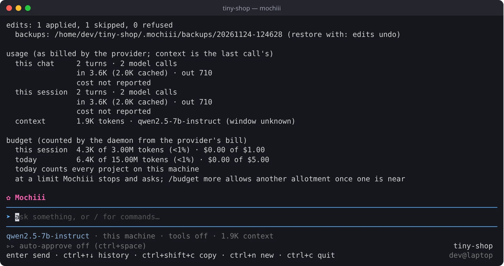

Mochiii adds up what every model call bills and stops to ask before going past a session's or a day's limit.

*Describes terminal app 1.6.1 and VS Code extension 1.0.1, which works with terminal app 1.6.1 or later.*

## The limits

| Limit | Default | Counts |
|---|---|---|
| This session | 3,000,000 tokens or $1.00 | One run of the client |
| Today | 15,000,000 tokens or $5.00 | Every project on this computer |

Tokens are always counted; dollars where the provider reports them. At 80% you are told once. At a limit Mochiii stops and asks: the turn in progress ends with a summary of what it did, and the next question is refused before it reaches the model, until you type `/budget more` to allow another allotment. A long task stops the same way and is saved for `/task resume`.

## See where you stand

| Command | Client | What it shows |
|---|---|---|
| `/usage` | Terminal | Tokens in (and how many were cached), tokens out and dollars, for this chat and this session, and how full the context is |
| `/budget` | Terminal | This session's and today's spend against their limits |
| `/usage` | VS Code | The last turn's tokens and context |
| `/cost` | VS Code | What the last turn cost, as the provider billed it |
| **⋯ → Account** | VS Code | This session's and today's spend |

These answer from the provider's own bill, not an estimate, and cost no model call.

<Note>
  The VS Code panel sends no session yet, so only the day's limit holds it there.
</Note>

The limits are set under `mcp.budget.spend` in [models.json](/reference/models-json).
