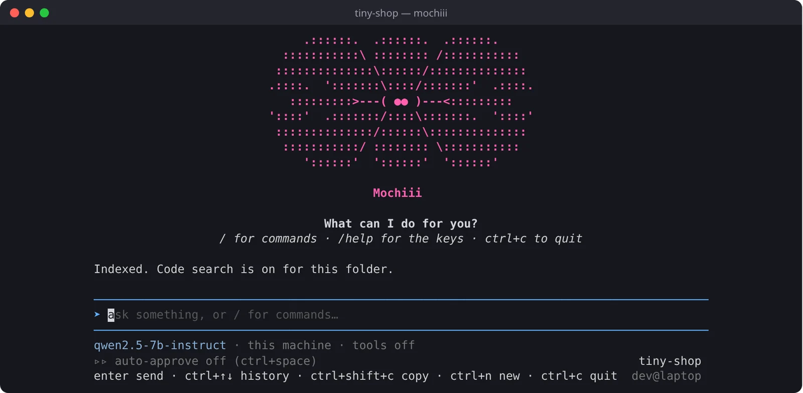
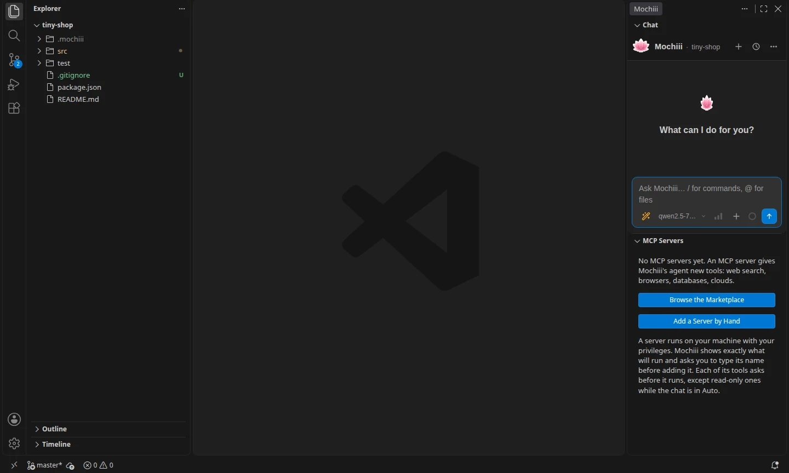

The first time you open a folder, Mochiii offers to index it for code search and asks you to connect a model.

*Describes terminal app 1.6.1 and VS Code extension 1.0.2, which works with terminal app 1.6.1 or later.*

## In the terminal app

<Steps>
  <Step title="Start it in the project">
    ```bash
    cd path/to/your/project
    mochiii
    ```

    Started in your home folder or at the top of a drive, Mochiii says so and suggests a project folder. It still runs, but code search is never offered there.
  </Step>
  <Step title="Index the folder">
    The first time, Mochiii offers to download its code-search model (once for your computer) and to index the folder:

    ![The terminal app asking "Index /home/dev/tiny-shop now? [Y/n/never]"](/images/screens/terminal-first-run-index.webp)

    `Y` or Enter builds the index, `n` skips it this time, and `never` stops asking for this folder.
  </Step>
  <Step title="Connect a model">
    With no key yet, Mochiii opens on its setup: choose a provider, paste its key, choose a model. `Esc` skips to the chat, and a key is asked for when you send your first question. See [Choosing a model](/models/choosing-a-model).
  </Step>
  <Step title="Ask">
    The first screen is the lotus, "What can I do for you?" and the prompt, ready to type into.

    
  </Step>
</Steps>

| Command | Effect |
|---|---|
| `mochiii --index` | Index the folder again, then open the chat |
| `mochiii --no-index` | Do not offer to index this folder |
| `MOCHIII_NO_INDEX=1 mochiii` | The same as `--no-index` |

**Each launch starts a new chat.** Quitting a chat you have not saved asks first. See [History, saved chats and /compact](/using/history).

## In VS Code

<Steps>
  <Step title="Open the chat">
    Click the lotus in the Activity Bar, or run **Mochiii: Open Chat**.
  </Step>
  <Step title="Index the folder">
{/* SCREENSHOT GAP: VS Code's index offer. The test folder was already indexed by the terminal app run, so the offer did not appear. */}

    Mochiii asks once per folder whether to index it. Later, run **Mochiii: Index Folder for Code Search**. The first index also downloads the code-search model, once for your computer.
  </Step>
  <Step title="Connect a model">
    Type `/connect`. See [Choosing a model](/models/choosing-a-model).
  </Step>
  <Step title="Ask">
    A new chat starts in Auto. The first question in Auto shows a one-time warning: see [Modes](/using/modes).
  </Step>
</Steps>



Without an index the agent can still read and search files with its tools.
