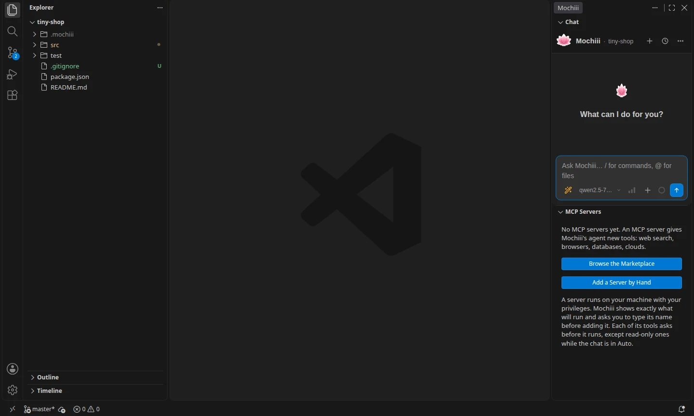

Install **Mochiii** from the VS Code Marketplace, open a project folder you trust, and click the lotus in the Activity Bar.

*Describes terminal app 1.6.1 and VS Code extension 1.0.1, which works with terminal app 1.6.1 or later.*

## Requirements

- **Linux x64 or Windows x64.** There is no macOS build of the extension yet; on a Mac, use the [terminal app](/getting-started/install-terminal).
- **VS Code 1.85 or later.**
- **A trusted workspace on this computer.** Remote SSH, WSL and Dev Containers are not supported yet.
- **Code search on Linux** needs glibc 2.27 or newer.

## Install

<Steps>
  <Step title="Install the extension">
    Install **Mochiii** from the [VS Code Marketplace](https://marketplace.visualstudio.com/items?itemName=MochiiiAIAgent.mochiii-vscode), or from a terminal:

    ```bash
    code --install-extension MochiiiAIAgent.mochiii-vscode
    ```
  </Step>
  <Step title="Open a project folder you trust">
    Mochiii works on the folder that is open in VS Code.
  </Step>
  <Step title="Open the chat">
    Click the lotus in the Activity Bar, or run **Mochiii: Open Chat** from the Command Palette.
  </Step>
  <Step title="Connect a model">
    Type `/connect` in the chat and paste a provider's key, or set up a model on your computer. See [Choosing a model](/models/choosing-a-model).
  </Step>
  <Step title="Ask a question">
    The first question in Auto shows a one-time warning first. See [Modes](/using/modes).
  </Step>
</Steps>



<Warning>
  **Using the terminal app too?** VS Code extension 1.0.1 works with terminal app 1.6.1 or later. Update the terminal app first. See [Update and uninstall](/getting-started/update-and-uninstall).
</Warning>

<Warning>
  **Installed a Mochiii `.vsix` by hand?** Uninstall it before installing from the Marketplace: VS Code will not replace a build numbered 1.1.0 to 1.6.1 with 1.0.1.
</Warning>
