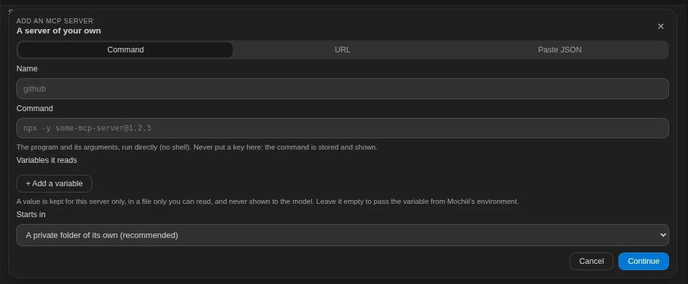

Add any MCP server by its command, its URL, or the JSON from its setup page; Mochiii shows what will run and adds it only after you type its name.

*Describes terminal app 1.6.1 and VS Code extension 1.0.2, which works with terminal app 1.6.1 or later.*

<Warning>
  A server you add runs as an ordinary program with your privileges. Mochiii cannot confine it. Only add a server whose program you trust.
</Warning>

## In VS Code

<Steps>
  <Step title="Open the form">
    **⋯ → Customize → MCP → Add server → Your own server**, or run **Mochiii: Add MCP Server…**. `/mcp-server add` in the chat opens the same form.
  </Step>
  <Step title="Describe the server">
    Pick **Command**, **URL** or **Paste JSON**.

    

    For a command: a name, the program and its arguments (run directly, no shell), the variables it reads, and where it starts. Never put a key in the command: it is stored and shown.
  </Step>
  <Step title="Confirm">
    **Continue** shows what will run. Type the server's name to add it.
  </Step>
</Steps>

## In the terminal app: paste JSON into /mcp

{/* SCREENSHOT GAP: the /mcp panel. In a pty run of terminal app 1.6.1 (npm, scrollback mode, no servers added), /mcp then Enter drew nothing, so no real screenshot exists. Described from docs/REFERENCE.md:1110-1166. */}

Type `/mcp` to open the panel of your servers, then paste the server's JSON straight into it. `a` opens a box for a command or a URL instead. The panel reads:

| Paste | From |
|---|---|
| `{"mcpServers": {"a": {...}}}` | Claude Desktop, Cursor, Cline, Claude Code; a whole config file is fine |
| `{"servers": {"a": {...}}}` | VS Code's `mcp.json` |
| `{"a": {...}, "b": {...}}` | The block on its own |
| `{"command": ..., "args": [...], "env": {...}}` | One program with no name; the panel asks for one |
| `{"url": ..., "type": "http"}` | One remote server with no name (`http`, `sse` or `streamable-http`) |

<Steps>
  <Step title="Review">
    One page shows every server in the paste: the exact command a program will run, or the exact address a remote server is sent to, and which keys the paste gave and which are missing.
  </Step>
  <Step title="Agree to each one">
    For each server, its warning, then its name typed to add it. Enter on an empty line skips it, `Esc` cancels them all. Nothing is added until the last answer.
  </Step>
  <Step title="Added and started">
    Each server is added and started, and a line says how it went: connected (with its tool count), needs a sign-in, needs a key, failed to start (and why), or skipped.
  </Step>
</Steps>

A field Mochiii does not know refuses the paste, naming the field, and the paste is put back in the box to fix. Cline's `autoApprove`, `alwaysAllow` and `timeout` are left out with a note: every tool still asks before it runs.

## In the terminal app: by command

```text
/mcp-server add files npx -y @modelcontextprotocol/server-filesystem /home/me/notes
```

Mochiii splits the line into words itself (quotes keep a path with spaces together) and runs no shell. It shows the exact command, that it runs with your privileges, its variables and where it starts; type the server's name to add it. It then starts the server once and says how many tools it offers. A first start can be slow while `npx` downloads the server; run `/mcp-server check files` to try again, with `--timeout 60` to wait longer.

| Command | What it does |
|---|---|
| `/mcp-server` | Your servers and whether each is connected, the tools the model would be offered, and any left off that list |
| `/mcp-server check [name] [--timeout N]` | Starts one server, or all of them, to see whether they work (N from 1 to 120 seconds) |
| `/mcp-server get <name>` | One server: its command, file, variables and where it starts |
| `/mcp-server disable <name>` / `enable <name>` | Pauses or resumes a server |
| `/mcp-server remove <name>` | Removes a server you added, and its keys |

## Where it starts

A server you add starts in a folder of its own, not in your project, because a launcher such as `npx` or `uvx` decides what to run partly from the folder it starts in. If a server only needs the project's files, give it the project's path as an argument. If it must start inside the project, choose that in VS Code's **Starts in**, or add it with `--in-project` in the terminal app; Mochiii warns what that means.

## A project's own servers

A project's `.mcp.json` can only propose a server. It shows as pending and does not start, not even for a check, until you approve it (`/mcp-server approve <name>`, or **Mochiii: Approve MCP Server the Project Proposes…**). The approval is for that exact definition in that folder: if the project changes it, you are asked again.

## Where it is kept

| What | Where |
|---|---|
| The servers you added: name, command, arguments and variable names | `~/.mochiii/mcp-servers.json`, readable only by you |
| Their keys | `~/.mochiii/mcp-secrets.json`, readable only by you |
| Servers you approved from a project's `.mcp.json` | `~/.mochiii/mcp-approvals.json` |

None of these is in your project, and the agent cannot add a server.
