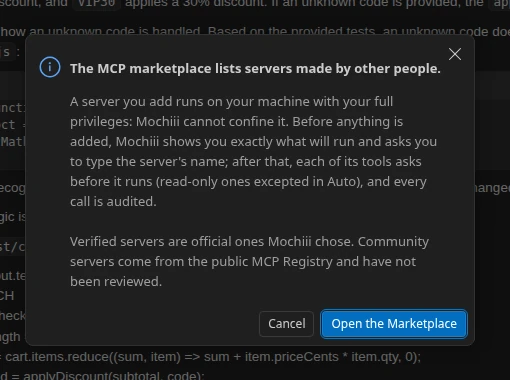
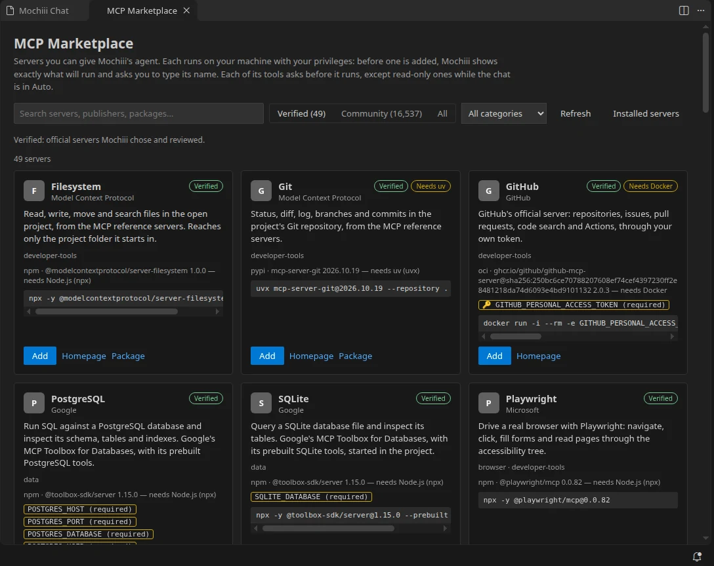

The Marketplace in VS Code lists MCP servers you can give Mochiii's agent, each with the exact command it runs; adding one takes one click and the server's name.

*Describes terminal app 1.6.1 and VS Code extension 1.0.2, which works with terminal app 1.6.1 or later.*

<Steps>
  <Step title="Open it">
    **⋯ → Customize → MCP → Add server → From the Marketplace**, or run **Mochiii: Browse MCP Marketplace**. The first time, Mochiii explains what adding a server means:

    
  </Step>
  <Step title="Pick a server">
    Search by name, publisher or package, and filter by category.

    
  </Step>
  <Step title="Add it">
    **Add** shows what will run and asks you to type the server's name. A key the server needs is asked for then; see [Keys and variables](/mcp/keys-and-variables).
  </Step>
</Steps>

## What a card tells you

- **Verified** servers are official ones Mochiii chose. **Community** servers come from the public MCP Registry and have not been reviewed.
- The package and the exact command the server runs.
- **Needs uv** or **Needs Docker**, for a server that launches with them; the other requirements, such as Node.js, are named beside the package.
- The keys and settings the server needs, marked `required`.
- The server's whole tool count.

## Where the list comes from

The Marketplace reads its catalog from `https://www.mochiii.in/api/mcp/v1/catalog.json`, so the list can change without a new version of Mochiii. The `mochiii.mcp.catalogUrl` setting points it elsewhere; it is machine-scoped, so a project cannot choose the list. Every entry is still checked by the extension.

The terminal app has no Marketplace: add a server there with `/mcp` or `/mcp-server add`. See [Add your own server](/mcp/add-a-server).
