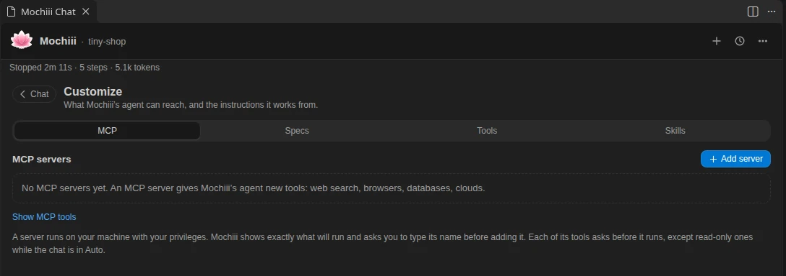

An MCP server is a program, or a remote service, that gives Mochiii's agent more tools, such as web search, browsers, databases and clouds.

*Describes terminal app 1.6.1 and VS Code extension 1.0.1, which works with terminal app 1.6.1 or later.*

<Warning>
  A server you add runs on your computer with your privileges: Mochiii cannot confine it. Only add a server whose program you trust.
</Warning>

## Where to add one

<CardGroup cols={2}>
  <Card title="The Marketplace" icon="store" href="/mcp/marketplace">
    In VS Code: verified servers, with the exact command each one runs.
  </Card>
  <Card title="Your own server" icon="terminal" href="/mcp/add-a-server">
    A command, a URL, or JSON pasted from a server's setup page. Both clients.
  </Card>
  <Card title="Keys and variables" icon="key" href="/mcp/keys-and-variables">
    How a server gets its key, and where the key is kept.
  </Card>
  <Card title="Troubleshooting" icon="wrench" href="/mcp/troubleshooting">
    A server that will not start, or tools the model does not use.
  </Card>
</CardGroup>

In VS Code, your servers are under **⋯ → Customize → MCP**, and in the **MCP Servers** view under the chat. In the terminal app, `/mcp` opens a panel of them, and `/mcp-server` does the same by command.

## What a server can do

- **Before anything is added,** Mochiii shows exactly what will run (the command and its arguments, or the address) and asks you to type the server's name.
- **Each of its tools asks before it runs.** In VS Code's Auto, a tool the server marks read-only runs without asking. Every call is recorded in the project's audit log.
- **Remote servers** are reached over `https` (plain `http` only for this computer), at the address you agreed to.
- **Tools only:** Mochiii uses a server's tools, not its resources or prompts.
- **A project cannot start a server by itself.** A project's `.mcp.json` can only propose one, and it does not start until you approve it.

## How many tools the model sees

The model is shown at most 24 tools at a time, Mochiii's own first. When a server's tools do not all fit, the model reaches the rest with `find_tools`, and adding the server tells you how many of its tools are on the default list. A server with many tools, such as redis (53 tools) or github (46), gets only some of them on the menu at once.
