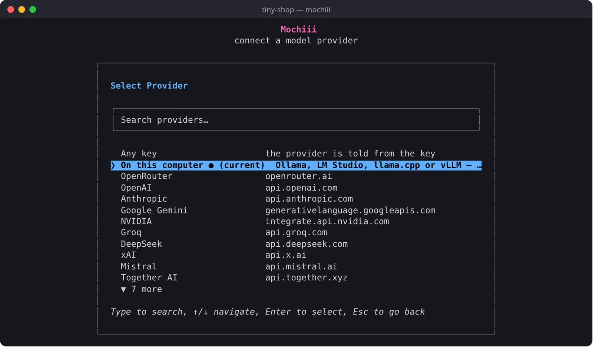

Mochiii answers with a model you choose: your own key from one of 17 providers, or a model server on your computer.

*Describes terminal app 1.6.1 and VS Code extension 1.0.2, which works with terminal app 1.6.1 or later.*

<CardGroup cols={2}>
  <Card title="A provider's key" icon="key" href="/models/other-providers">
    OpenRouter, Anthropic, Google Gemini, Groq and 13 more.
  </Card>
  <Card title="A model on your computer" icon="laptop" href="/models/local-models">
    Ollama, LM Studio, llama.cpp or vLLM, with no key.
  </Card>
</CardGroup>

## Connect in the terminal app

<Steps>
  <Step title="Open the list">
    Type `/provider` (or `/connect`). Type to search, Enter to pick. **Any key** tells the provider from the key; **On this computer** is for a local model server.

    
  </Step>
  <Step title="Paste the key">
    The next screen takes the key in a masked box and says where it is about to be sent. Mochiii checks it with that provider before it stores it. A refused key is refused by name, changes nothing, and leaves you on that screen to try again.
  </Step>
  <Step title="Pick a model">
    The last screen lists the provider's models. Enter makes one the model; Esc keeps the one in use.
  </Step>
</Steps>

The same screens open by themselves when no key is in use. `/model` opens the model list alone, and `/model list` prints it.

## Connect in VS Code

Type `/connect` in the chat: choose a provider, paste its key, choose a model. `/connect <provider>` skips the list. The model chip under the prompt changes the model, and the **Account** page (**⋯ → Account**) shows the provider, the key and the model in use.

## Which key and model are in use

| Command | What it does |
|---|---|
| `/connect show` | Which key is in use, never the key itself |
| `/connect forget` | Removes the stored key. In VS Code, Forget key asks first |
| `/account` | The provider, the key in use and where it comes from, the model, and the spend |
| `/model <name>` | Selects a model. The choice is remembered across restarts |
| `/model clear` | Back to the model the provider check found, or the default tier |

A key from the environment (`MOCHIII_API_KEY`) wins over a stored one, and `/connect show` says when that is the case.

## Picking a model

- **On OpenRouter**, `/model` offers the [built-in tiers](/models/openrouter#models); the default is DeepSeek V4 Pro.
- **On any other provider**, `/model` lists that provider's own models.
- **Agent features** ([long tasks](/features/long-tasks), [specs](/features/specs), MCP tools) need a model that can use tools.
