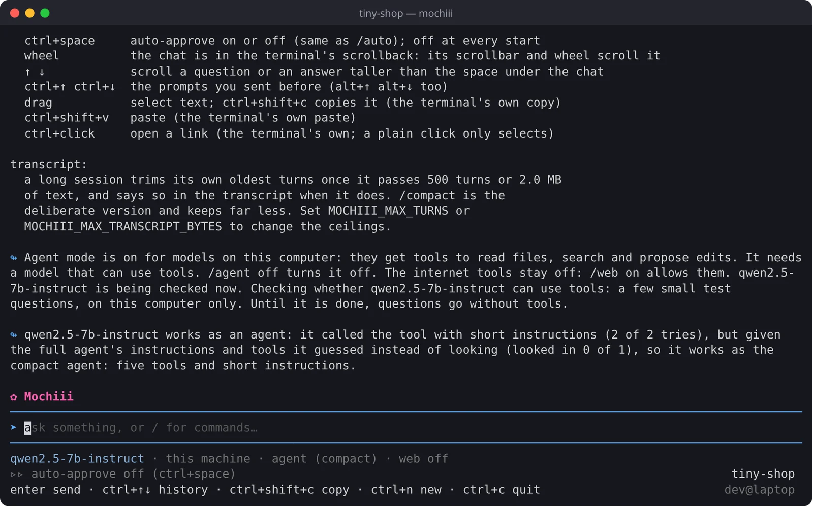

Run a model server on your computer (Ollama, LM Studio, llama.cpp or vLLM) and point Mochiii at it; no key is needed.

*Describes terminal app 1.6.1 and VS Code extension 1.0.2, which works with terminal app 1.6.1 or later.*

## In the terminal app

<Steps>
  <Step title="Start the server">
    For Ollama:

    ```bash
    ollama serve
    ollama pull qwen2.5-coder:7b
    ```
  </Step>
  <Step title="Connect">
    Pick **On this computer** from `/provider`, or run `/connect local`. Mochiii looks for a server on `127.0.0.1` at each one's usual port (11434, 1234, 8080, 8000), tells them apart by what they serve, and lists their models. For a server at another port, use `/connect http://localhost:<port>/v1`.
  </Step>
  <Step title="Turn on tools, if the model can use them">
    A model on your computer gets the code that matters with each question, and no tools, until you type `/agent on`.
  </Step>
</Steps>

## How Mochiii picks full agent, compact agent or chat

`/agent on` first tries the model, up to three times, with one tool and a question only that tool answers. It then uses the model one of three ways, shown on the line under the prompt:

| Way | When | What the model gets |
|---|---|---|
| **Full agent** | Its window is 24,576 tokens or more, and with the full agent's instructions it looked the code up in all three tries | The full instructions and tools |
| **Compact agent** | It called the tool with short instructions and its window is 8,192 tokens or more, but the window is under 24,576 or it did not call the tool under the full instructions | Short instructions and five tools: `read_file`, `search_code`, `list_directory`, `propose_edit`, `run_command` |
| **Chat** | It did not call the tool, its server says it has no tools, or its window is under 8,192 tokens | Your code with each question; any edit it proposes is shown for review |



The result is kept per model and window. `/agent check` checks again, and `/agent off` takes the tools away. On a laptop's CPU the check can take a few minutes; questions are answered without tools until it is done.

## Which models can use tools

It depends on the model, not on its size or on its server's label. Measured by Mochiii's developers: `qwen2.5-coder:3b`, which Ollama lists as able to use tools, made no valid tool call in 15 tries, and `qwen2.5-coder:7b` used tools only under short instructions. Pick a model of 7B or more.

## The context window

Mochiii reads the model's context window from the server and sends only as much code as fits, and says so once, with how to make the window bigger. Ollama gives a model 4,096 tokens unless started with more, for example:

```bash
OLLAMA_CONTEXT_LENGTH=16384 ollama serve
```

The compact agent needs 8,192 tokens or more, and the full agent 24,576 or more.

## Internet tools

`web_search` and `web_fetch` stay off for a model on your computer, even with `/agent on`, until you type `/web on`. See [Web tools](/features/web-tools).

## In VS Code

Set `mochiii.apiBase` to the server's address (for Ollama, `http://localhost:11434/v1`) and `mochiii.model` to the model's name in VS Code's Settings, then run **Mochiii: Restart Daemon**. The `/agent` check and the compact agent are in the terminal app only.

<Note>
  With only a local server set, extension 1.0.1 still shows "Mochiii has no API key, so the model cannot be reached…" when it starts. Choose **Not now**: questions go to the server in `mochiii.apiBase` without a key.
</Note>
