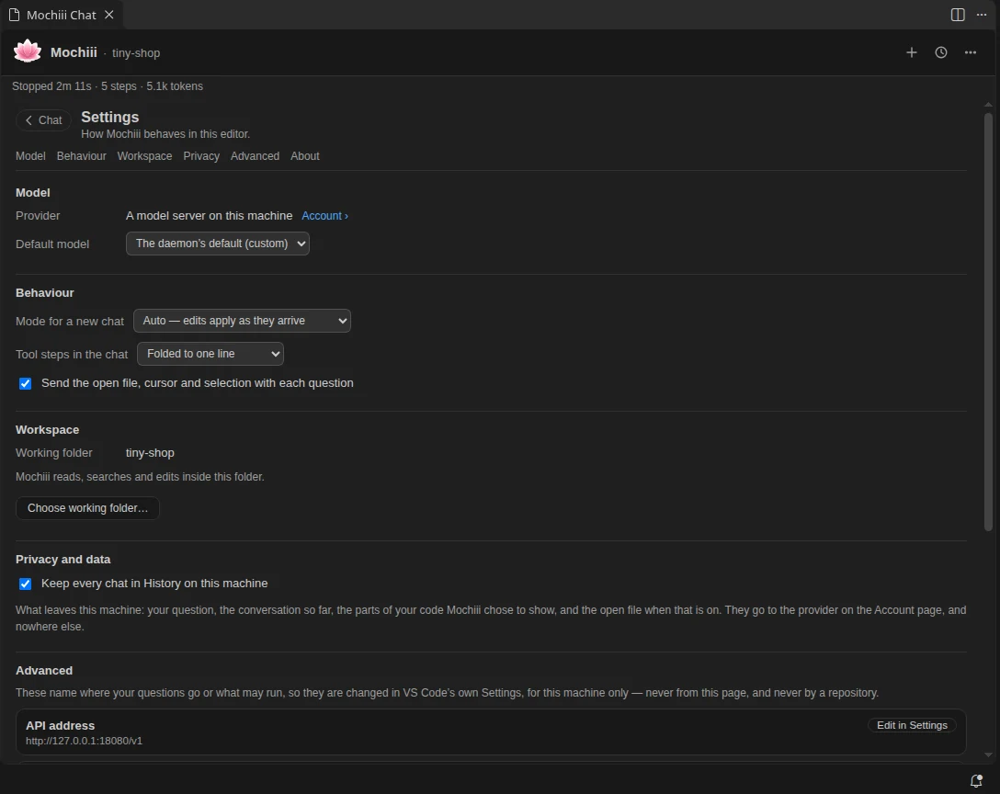

The extension has nine settings, all under `mochiii.` in VS Code's Settings; the ones that decide where your prompts go or what runs can only be set for your machine, never by a project.

*Describes terminal app 1.6.1 and VS Code extension 1.0.2, which works with terminal app 1.6.1 or later.*

| Setting | Default | What it does |
|---|---|---|
| `mochiii.apiBase` | empty | The model API address, for example `https://openrouter.ai/api/v1` or a server on your computer. Empty uses Mochiii's default. Overrides `MOCHIII_API_BASE`. Machine only |
| `mochiii.model` | empty | The one model to use, named the way the server at `mochiii.apiBase` names it, for example `qwen2.5-coder:7b`. Replaces every model in `models.json`. Machine only |
| `mochiii.configPath` | empty | An absolute path to a `models.json` to load instead of the bundled one, for example to add MCP servers under `mcp.servers` or change a tool's policy. A relative path is refused. Machine only |
| `mochiii.sendEditorContext` | on | Sends the open file with each question: path, cursor line, selection, other tabs' names, and the file (whole up to 6 KB, otherwise up to 6 KB around the cursor). Only files inside the workspace |
| `mochiii.toolActivity` | `compact` | How a turn's tool work is shown: `compact` folds it to one line (click to see each step), `expanded` shows one row per step |
| `mochiii.developerDiagnostics` | off | Shows which internal component reported each notice. The full record is always in the log (**Mochiii: Show Daemon Log**) |
| `mochiii.defaultMode` | `auto` | The mode a new chat starts in: `auto`, `manual` or `plan`. Only your user setting counts, so a project cannot turn Auto on |
| `mochiii.history.autoSave` | on | Keeps every chat in History, up to 50 chats and 20 MB per workspace. Off keeps only the chats you bookmark |
| `mochiii.mcp.catalogUrl` | empty | Where the MCP Marketplace reads its catalog; empty uses `https://www.mochiii.in/api/mcp/v1/catalog.json`. Must be `https://`. Machine only |

**Machine only** means the setting is read from your user settings on this machine; a workspace's `.vscode/settings.json` cannot set it, so a repository cannot send your prompts elsewhere or choose what runs.

After changing `mochiii.apiBase`, `mochiii.model` or `mochiii.configPath`, run **Mochiii: Restart Daemon**.

The **Settings** page in the panel (**⋯ → Settings**) shows these with the provider, the working folder and what leaves your machine; the address settings there open VS Code's own Settings, so they are changed on this machine only.
