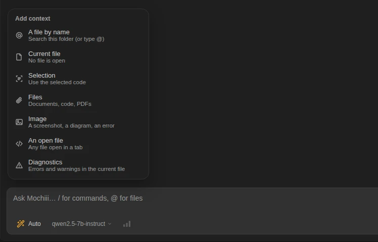

Give Mochiii more to go on: mention a file with `@`, attach documents and images, or let it see the file you have open.

*Describes terminal app 1.6.1 and VS Code extension 1.0.2, which works with terminal app 1.6.1 or later.*

## The + menu (VS Code)

| Item | What it adds |
|---|---|
| A file by name | Any file in the folder, found by name. Typing `@` in the prompt opens the same search |
| Current file | The file open in the editor |
| Selection | The selected code |
| Files | Documents, code and PDFs from disk |
| Image | A screenshot, a diagram, an error |
| An open file | Any file open in a tab, unsaved changes included |
| Diagnostics | VS Code's errors and warnings for the current file |

A mentioned or open file is read through VS Code, so its unsaved text is what is sent.

## Attachments

Up to 8 files per question. Each is turned into text on your machine, and only that text goes with the question.

| You attach | What Mochiii reads | Limits |
|---|---|---|
| Text and code (`.txt`, `.md`, `.json`, `.js`, `.ts`, `.py`, `.go`, `.java`, `.csv`, `.yaml`, `.sql`, `.log` and more) | The text | 10 MB a file |
| PDF | The text of each page; scanned pages by OCR | 100 MB, 200 pages, 30 scanned pages |
| Word (`.docx`) | The text | 200 MB |
| Excel (`.xlsx`, `.xlsm`) | The sheets, as text | 20 sheets, 2,000 rows a sheet, 50 columns a row |
| PowerPoint (`.pptx`) | The slides' text | 200 slides |
| Images (`.png`, `.jpg`, `.jpeg`, `.webp`, `.gif`, `.bmp`) | The text in the image, by OCR. The picture itself is not sent | 20 MB, 90 seconds per image |
| `.doc`, `.xls`, `.ppt` | Not read: "the old format is not supported". Save it as `.docx`, `.xlsx`, `.pptx` or PDF |  |
| Anything else | Not read: "this file type is not supported" |  |

At most 80,000 characters of an attachment go with the question; a limit that cuts the text short says so beside the attachment.

<Note>
  Text read by OCR can contain misreadings, such as currency symbols read as digits or addresses missing their dots. Mochiii tells the model so, and asks it to quote such parts as they are rather than guess.
</Note>

## The file you have open

With `mochiii.sendEditorContext` on (the default), each question carries the file you have open: its path, your cursor line, your selection, the names of your other open tabs, and the file itself, whole when it is 6 KB or less, otherwise the lines around your cursor or selection, up to 6 KB. Only files inside the workspace are sent. Turn it off to send nothing but what you type.

Every question also carries the project's name and its top two levels of folders, never secret files.

## In the terminal app

The terminal app has no attachments. What `/git` and `/search` print, and what `/issue` and `/pr` show, is sent to the model once, with your next question. In agent mode, a `file:line` reference in your question (`foo.go:142`) is attached up front.
