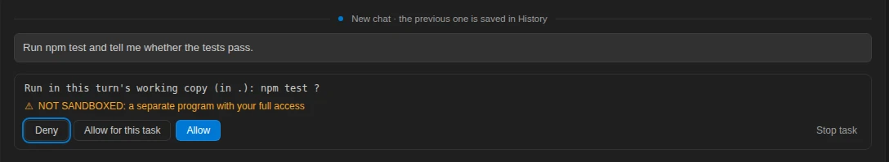
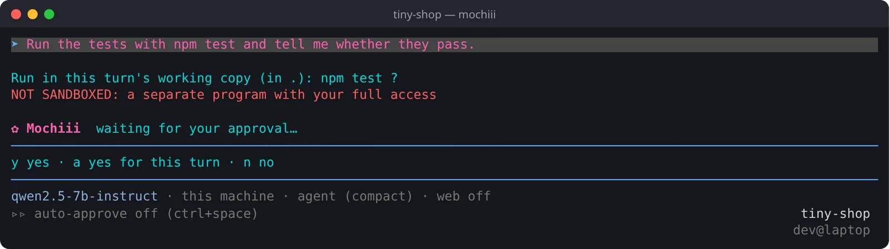
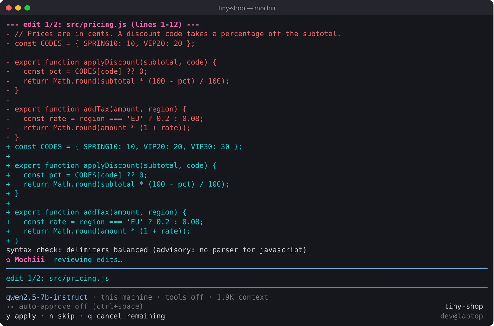

Before a tool call that is not allowed outright, Mochiii stops and asks you, showing exactly what will run; your answer covers that call, the rest of the task, or nothing.

*Describes terminal app 1.6.1 and VS Code extension 1.0.2, which works with terminal app 1.6.1 or later.*

## What asks first

Each tool has a policy: `allow` runs without asking, `ask` asks you first, `deny` never offers it. A tool from an MCP server asks, and so does any tool with no policy listed. Running a terminal command (`run_command`), deleting, moving and restoring files always ask. See [Built-in tools](/reference/built-in-tools) for every tool's policy.

In VS Code, **Auto** answers these questions for you inside the project, and **Manual** leaves them all to you: see [Modes](/using/modes). In the terminal app, **auto-approve** (`Ctrl+Space`) answers them for you.

## In VS Code

| Button | What it does |
|---|---|
| **Deny** | Does not run it; the model is told you declined. It has the focus, and `Esc` presses it |
| **Allow for this task** | Runs this call, and the same call again for the rest of the task; a different command still asks |
| **Allow while this spec is active** | Runs this exact command now and again while the active spec stays on. Offered only for a build or test command with a spec active |
| **Allow** | Runs this call with these exact arguments |
| **Stop task** | Denies the call and abandons the whole task |

No single key allows: text typed into the composer never approves anything. In Auto, a question Auto leaves to you carries one line saying why, for example "Auto asks first: this can send something out of this computer."

## In the terminal app

| Key | What it does |
|---|---|
| `y` | Runs this call |
| `a` | Runs it, and lets the same call run without asking for the rest of the turn (in a long task, the whole task) |
| `s` | Runs this build or test command, and the same command again while the active spec stays active. Shown only then |
| `n` | Does not run it. The model is told you declined |
| `Esc` | Does not run it, and stops the turn |

A letter answers only when it is typed on its own, after the question has been on screen for half a second, so typed text never answers a question. If the question is longer than the screen, `y` does nothing until you have paged to the end.

After you answer, a line stays in the chat, for example `✓ approved builtin__run_command`.

## The question

The question says what will happen, with the arguments in full. A line under it can warn you:

- `NOT SANDBOXED: a separate program with your full access`, for a shell command or a tool from an MCP server
- `marked destructive`, for an MCP tool the server gives hints for, unless the server says it is not destructive or declares it read-only
- `RUNS IN YOUR REAL PROJECT`, for a command that would run in the project itself because no separate working copy could be made

A tool from an MCP server is named with its server, for example `Allow cloudflare/search_cloudflare_documentation`.

A question waits for your answer for as long as you take; that time is not counted against the turn. Closing the terminal or the panel ends it at once, as a no.

## How long a yes lasts

- **Allow / `y`** covers this call.
- **Allow for this task / `a`** lasts until the task or turn ends, and is never written to disk. For a command, a web call or a tool marked destructive it covers only the same arguments again; for a file outside the project, only that path; for any other tool, every later call to it.
- **Allow while this spec is active / `s`** lasts across turns while the same spec stays active. It ends when you type `/spec off`, choose another spec, or quit.

## Secrets in a tool call

A secret the model writes into a third-party tool's arguments is redacted before you are asked and before it is sent: a recognisable key format, or a value whose name says it is a secret (`password`, `DB_PASSWORD=`). A call that carries one of the keys Mochiii itself holds (your provider key, an MCP server's key, your GitHub token) is refused outright.

## Edits

An edit passes five checks before it is written: the path stays inside the project and is not a secret file; the text to replace matches exactly one place; a Go file still parses (other languages are checked for balance only); you confirm it (or Auto, or auto-approve, does); and a copy is backed up. In the terminal app, each edit is shown as a diff: `y` applies it, `n` skips it, `q` cancels the rest.

The review is where you catch what the model did that you did not ask for, like the dropped comment above.

See [Undo and backups](/using/undo-and-backups).

## Every decision is recorded

Each decision, including calls that ran without asking, is appended to `.mochiii/logs/toolcalls.jsonl` in the project. It records a SHA-256 of the arguments and their length, not the arguments themselves. Auto's and auto-approve's answers are recorded as `auto_approve`, not as yours.
