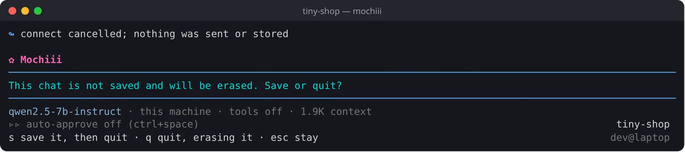

Each client keeps its own chats: VS Code saves every chat in History by itself, and the terminal app keeps a chat only when you `/save` it.

*Describes terminal app 1.6.1 and VS Code extension 1.0.2, which works with terminal app 1.6.1 or later.*

## Whose chat is whose

- **The terminal app and VS Code do not share a chat.** Each has its own chat, its own saved chats, its own search and its own "new chat". Your code index, saved rules and spending limits are shared, because they belong to the project.
- **Each terminal window has its own chat.** Saved chats are the terminal's, so a chat you `/save` in one window is in the other's `/history`.
- **VS Code windows** open on the same folder share one chat.

## In VS Code

**History** (the clock in the panel's header) lists every chat, newest first, with a search that matches what was said. A chat is saved when you start a new one, open another from History, or compact it. Up to 50 chats and 20 MB per workspace are kept; a chat you bookmark (**⋯ → Bookmark this chat**) is never removed. Turn off `mochiii.history.autoSave` to keep only the chats you bookmark.

## In the terminal app

**Each launch starts a new chat.** Before the screen opens, Mochiii erases the chat it was holding for the folder; only a chat you saved is kept. Quitting a chat you have not saved asks first:

`/clear` and `Ctrl+N` ask too: `s` saves the chat and then starts a new one, `c` starts a new one without saving, `Esc` keeps the chat. Closing the terminal window cannot ask, so a chat left that way is erased by the next launch.

| Command | What it does |
|---|---|
| `/save [name]` | Saves the chat. Saving again after more work updates its saved copy, and an update only adds |
| `/history` | Lists the saved chats, numbered. `⚠` marks a chat whose last answer did not finish, or whose spec still has open criteria |
| `/history <n>` | Reads saved chat `n` |
| `/resume <n>` | Continues saved chat `n` |
| `/history delete <n>` | Deletes saved chat `n` |

`<n>` is the chat's number in the list or the name you saved it under. Case does not matter, and the start of a name is enough to read or continue a chat if it fits only one; to delete, give the whole name.

A chat left behind by a terminal window that was closed is removed once nothing has been said in it for seven days.

## /compact

`/compact` summarises the earlier part of the chat to save context. The whole chat is kept in History first. In the terminal app, a long session also trims its own oldest turns once it passes 500 turns or 2.0 MB of text, and says so; `/compact` is the deliberate version and keeps far less.

## Where saved chats are kept, and limits

Saved chats are in `~/.local/state/mochiii/history/`, one gzipped file per chat, in a folder for each project and inside it one for each client: `terminal` and `vscode`. Never inside the project.

- At most **50** saved chats per project in each client, and **20 MiB** for the whole folder. Past that, the oldest are removed, and Mochiii says so.
- At most **8 MiB** of text in one saved chat.
- To remove every saved chat, delete the `history` folder.

<Note>
  **Coming from 1.5 or earlier?** The chat that was current became the VS Code panel's, and every chat you had saved was copied into both lists.
</Note>
