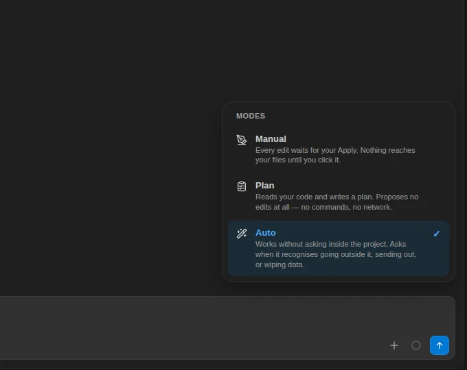
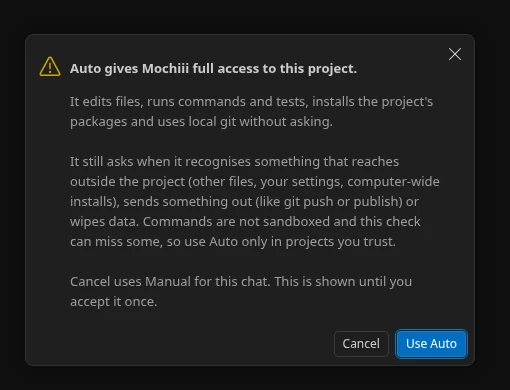
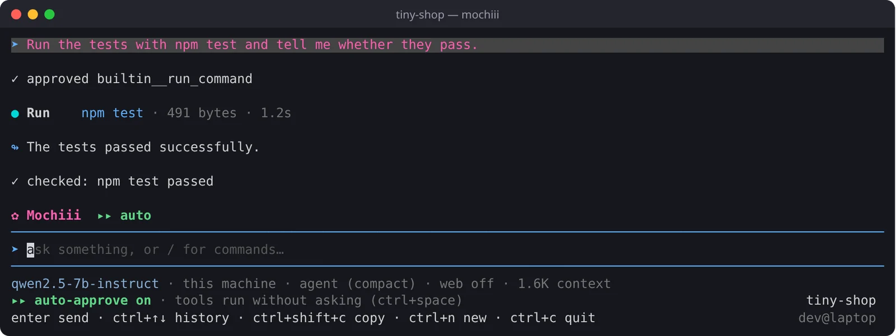

In VS Code each chat has a mode that decides what Mochiii does without asking: Auto (full access inside the project), Manual (every edit waits for you) or Plan (no edits at all).

*Describes terminal app 1.6.1 and VS Code extension 1.0.2, which works with terminal app 1.6.1 or later.*

| Mode | What it does |
|---|---|
| **Auto** | Works without asking inside the project. Asks when it recognises going outside it, sending out, or wiping data. A new chat starts here |
| **Manual** | Every edit waits for your Apply. Nothing reaches your files until you click it. Commands ask first |
| **Plan** | Reads your code and writes a plan. Proposes no edits at all: no commands, no network |

Change a chat's mode from the button beside the model, or with `/mode auto`, `/mode manual` or `/mode plan`.

## Auto

Auto is full access inside the project. It edits files, runs commands and tests, installs the project's packages and uses local git without asking.

<Warning>
  Commands are not sandboxed, and the check below can miss some. Use Auto only in projects you trust.
</Warning>

The first time you use Auto, Mochiii asks once:

**Use Auto** turns it on for this installation. **Cancel** uses Manual for this chat, and the warning is shown again until you accept it once.

Auto still asks, with one line on the approval card saying why, when it recognises that a call:

| The card says | For example |
|---|---|
| Auto asks first: this reaches outside the project. | A file outside the project, your settings, a computer-wide install |
| Auto asks first: this can send something out of this computer. | `git push`, publishing |
| Auto asks first: this can wipe data. | A command recognised as wiping data |
| Auto asks first: it can't tell what this would run. | A line that hides which program it runs |

A tool from an MCP server runs without asking in Auto only when the server marks it read-only. What Mochiii refuses (key files, credentials, tools the configuration denies) stays refused in every mode.

In Auto and Plan, a long task continues by itself, up to an hour or 400 steps, then offers **Resume**. See [Long tasks](/features/long-tasks).

## Manual

Every edit waits for your **Apply**, and every command asks. The approval card offers **Deny**, **Allow for this task** and **Allow**. See [Approvals and permissions](/using/approvals). In Manual nothing continues by itself.

## Plan

Mochiii reads your code and writes a plan. It has only read-only tools: nothing that edits or deletes a file, runs a command or reaches the internet, and no tools from your MCP servers. To carry out the plan, switch to Auto or Manual and ask again.

## The mode a new chat starts in

The `mochiii.defaultMode` setting (`auto`, `manual` or `plan`; `auto` by default). Only your own user setting counts: a project's `.vscode/settings.json` cannot turn Auto on.

## The terminal app

The terminal app asks before a command and shows each edit as a diff, unless you turn on **auto-approve**:

- `Ctrl+Space`, or `/auto` (`/auto on`, `/auto off`) where the terminal or the system takes that key.
- While it is on, a call that would ask runs as if you had pressed `y`, and edits are applied without the review, backups kept.
- Two still ask: reading a file outside the project, and a command that would run in the project folder itself because no separate working copy could be made.
- It is off every time Mochiii starts. The line above the prompt says `▸▸ auto` while it is on.

`/plan <request>` asks for a plan in one turn, with the same read-only limits as Plan mode. A `/plan` turn offers no edits.
