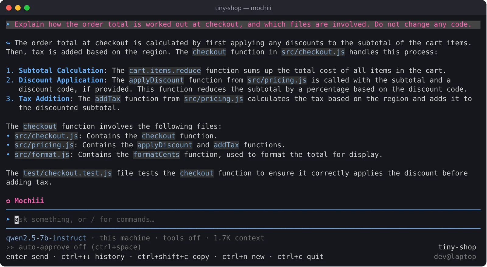
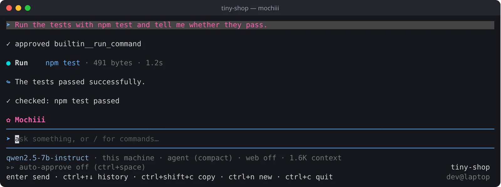

Type a question at the `➤` prompt; the chat prints into your terminal's own scrollback, so you scroll, select and copy it the way you do any terminal output.

*Describes terminal app 1.6.1 and VS Code extension 1.0.2, which works with terminal app 1.6.1 or later.*

## The screen

- **Your questions** are shaded bars starting with `➤`; **answers** start with `↬`.
- **While a turn runs**, the chat ends in a spinner line, "thinking…" then "working…", with the key that stops it.
- **The prompt** sits between two rules, blue while Mochiii waits for you and grey while a turn runs. A long prompt grows downwards, up to six rows.
- **Under the prompt:** the model, its provider, how full its context was at the last request, the session's cost, whether auto-approve is on, and the keys. In the bottom right corner: the project folder's name, and your user and machine name.

## Tool calls

In agent mode each call the model makes is one line: what was done, to what, and how much went back to the model.

- The target (file, folder, command, address) is blue.
- A hollow dot means the call is still running.
- Red means it did not happen: it failed, you declined it, or it was not allowed.

## Keys

| Key | What it does |
|---|---|
| `Esc` | Stops the turn in flight; the chat is kept |
| `Ctrl+C` | Stops the turn in flight, or quits when nothing is running (asks first if the chat is not saved) |
| `Ctrl+N` | Starts a new chat, as `/clear` does |
| `Ctrl+Space` | Auto-approve on or off, as `/auto` does; off at every start. See [Modes](/using/modes#the-terminal-app) |
| `Ctrl+↑` `Ctrl+↓` | The prompts you sent before (`Alt+↑` `Alt+↓` too) |
| `↑` `↓` | Scroll a question or an answer taller than the space under the chat |
| Drag, then `Ctrl+Shift+C` | Select and copy, with the terminal's own copy (`Cmd+C` on a Mac) |
| `Ctrl+Shift+V` | Paste, with the terminal's own paste (`Cmd+V` on a Mac) |
| `Ctrl+click` | Opens a link (`Cmd+click` on a Mac); a plain click only selects |

`/help` lists every command and these keys.

## Scrolling and copying

The terminal's scrollbar and mouse wheel move through the whole chat, a drag selects any length of it, and the chat stays in the terminal after you quit. `/copy` prints the whole chat again with no line cut at the window's edge, so a copied paragraph stays one line.

`mochiii --fullscreen` (or `MOCHIII_FULLSCREEN=1`) draws the chat on the terminal's full screen instead, with no scrollback. `/mouse` gives the mouse to the app, so selecting then needs `Shift`+drag.

## Each launch starts a new chat

Before the screen opens, Mochiii erases the chat it was holding for the folder, so only a chat you saved is kept. Each terminal window has its own chat. See [History, saved chats and /compact](/using/history).

## Long chats

A long session trims its own oldest turns once it passes 500 turns or 2.0 MB of text, and says so. `MOCHIII_MAX_TURNS` and `MOCHIII_MAX_TRANSCRIPT_BYTES` change those limits; `/compact` is the deliberate version.
