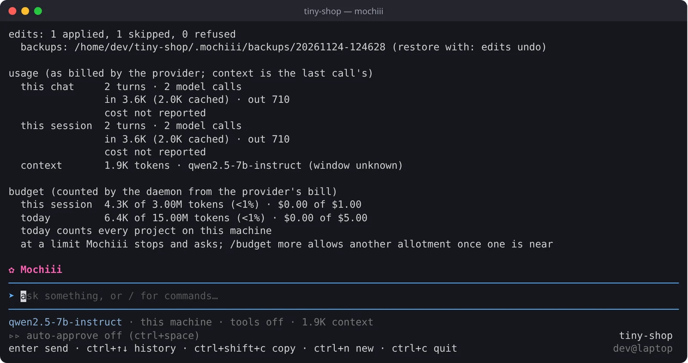
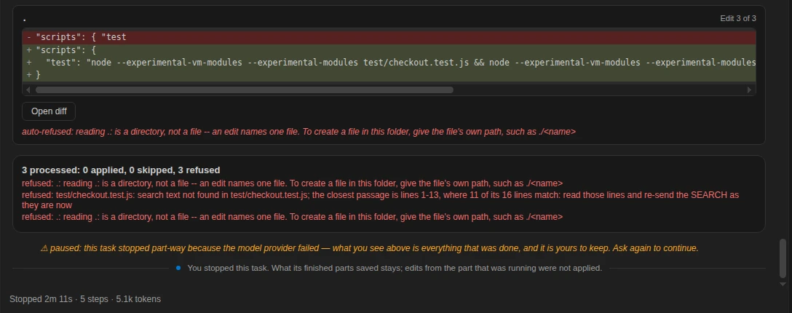

Every edit Mochiii applies is backed up first, so you can undo a whole run of edits in one step.

*Describes terminal app 1.6.1 and VS Code extension 1.0.2, which works with terminal app 1.6.1 or later.*

## What is kept

Before a file changes, Mochiii writes its content from before and after the edit to `.mochiii/backups/<timestamp>/` in the project. That holds in every mode, Auto and the terminal's auto-approve included.

A delete is a move to a trash the agent cannot reach: `.mochiii/trash/` in the project (or `~/.mochiii/trash/` for a file in your home folder). Nothing is destroyed, and the `restore_deleted` tool puts a file back.

## Undo in VS Code

{/* SCREENSHOT GAP: the "Undo this task's edits" button. The VS Code run applied no edits (all were refused), so the button did not appear. */}

When a task's edits are applied, the panel shows where the backup is, and an **Undo this task's edits** button.

## Undo in the terminal app

After the review, a summary names the backup folder:



To restore it, run in the project folder:

```bash
mochiii edits undo
```

| Option | What it does |
|---|---|
| `--session <timestamp>` | Restores that backup instead of the latest |
| `--workspace <path>` | The project, when you are not in its folder |
| `--force` | Restores a file even if it changed since the edit |

Undo first compares each file with the copy taken after the edit. A file you changed since is never silently overwritten: it is listed as guarded, and restored only with `--force`.

## Edits refused by a check

An edit that fails a check is refused and never written; the panel or the terminal says why.



## The working copy

A turn that edits or runs something does it in a separate working copy of the project first, so the agent can test its own changes. Your files change only when the edits are applied: when you accept them, or at once in Auto. `git` and package installers run in the real project, because the copy has no `.git` and installers change your environment.
