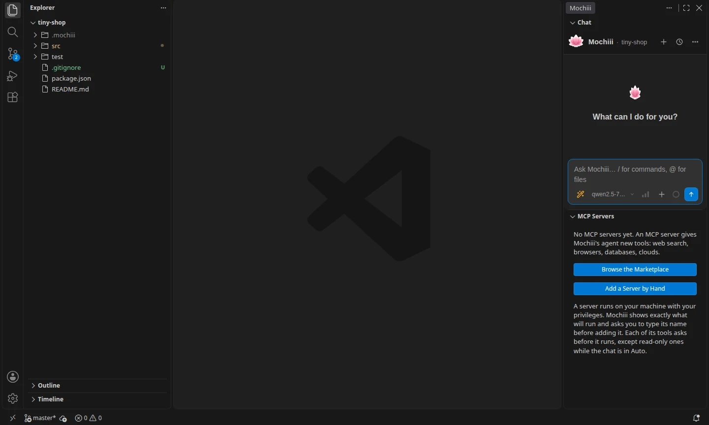
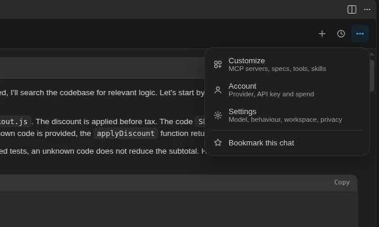
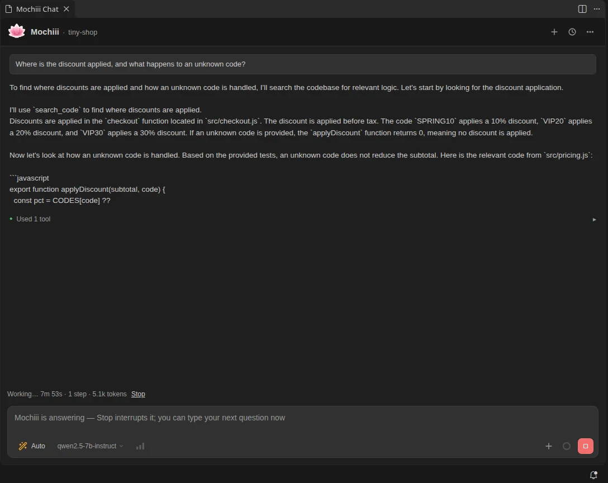

The Mochiii panel is a chat beside your code: ask a question, add context, pick a mode, and see what it does as it works.

*Describes terminal app 1.6.1 and VS Code extension 1.0.1, which works with terminal app 1.6.1 or later.*

## Open it

- Click the lotus in the Activity Bar, or run **Mochiii: Open Chat**.
- **Mochiii: Open Chat in Editor** opens it as an editor tab instead.
- Right-click a file or folder in the Explorer and choose **Add to Mochiii** to add it to the next question.

## The composer

A text box, and one row under it:

| Control | What it does |
|---|---|
| Mode | Auto, Manual or Plan for this chat. See [Modes](/using/modes) |
| Model | Choose the model |
| Thinking effort | Cycles Auto, Low, Medium and High: how long the model reasons before it answers |
| **+** | Add context: a file by name, the current file, the selection, files, images, problems. See [Adding context](/using/adding-context) |
| Ring | How much of the model's context the chat uses |
| Send | Sends; while Mochiii works it becomes Stop |

Type `/` for the commands and `@` to mention a file. One Enter runs the command you pick, and a `/command` the panel does not know is not sent to the model. See [Commands](/using/commands).

## The header

**New chat**, **History** (every chat, newest first, with search) and **⋯**, which opens the pages:

- **Customize:** MCP servers, specs, tools. See [MCP](/mcp/overview).
- **Account:** the provider, the key and the model in use, and the spend.
- **Settings:** the model, the mode for a new chat, the working folder, history. See [VS Code settings](/reference/vscode-settings).
- **Bookmark this chat:** a bookmarked chat is never removed from History.

## While it works

A line over the composer shows the time, the steps and the tokens while a task works, and the totals when it ends. In Auto and Plan a long task continues by itself; see [Long tasks](/features/long-tasks).

## What it sees

Every question carries the project's name and its top two levels of folders, never secret files, and the file you have open (`mochiii.sendEditorContext`). See [Adding context](/using/adding-context).

## Its own chat

The panel has its own chat, its own saved chats and its own search, apart from the terminal app's. VS Code windows open on the same folder share one chat. Your code index, saved rules and spending limits are shared with the terminal app, because they belong to the project.

## Commands in the Command Palette

| Command | What it does |
|---|---|
| Mochiii: Open Chat | Opens the panel |
| Mochiii: Open Chat in Editor | Opens the chat in an editor tab |
| Mochiii: Index Folder for Code Search | Builds the code index for the folder |
| Mochiii: Add to Mochiii | Adds the file or folder to the next question (Explorer) |
| Mochiii: Choose Working Folder | Picks the folder Mochiii works in, in a multi-folder workspace |
| Mochiii: Set API Key | Stores a provider key |
| Mochiii: Browse MCP Marketplace | Opens the Marketplace in an editor tab |
| Mochiii: Add MCP Server… | Adds a server of your own |
| Mochiii: Restart Daemon | Restarts the background service, for example after changing `mochiii.apiBase` |
| Mochiii: Show Daemon Log | The background service's log |

## When an answer does not arrive

A turn that hears nothing from the background service for 10 minutes (35 while a tool runs) ends with **No answer arrived** and **Try again**. Time waiting for your approval does not count.
